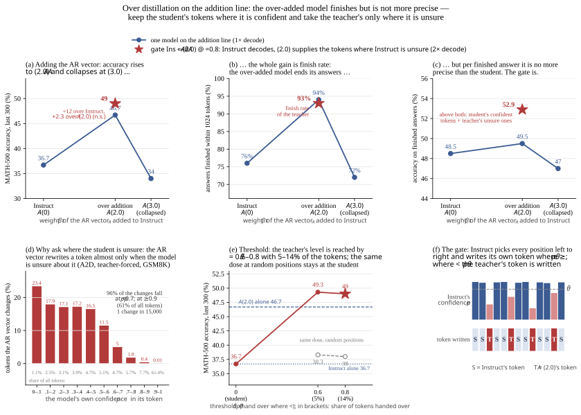
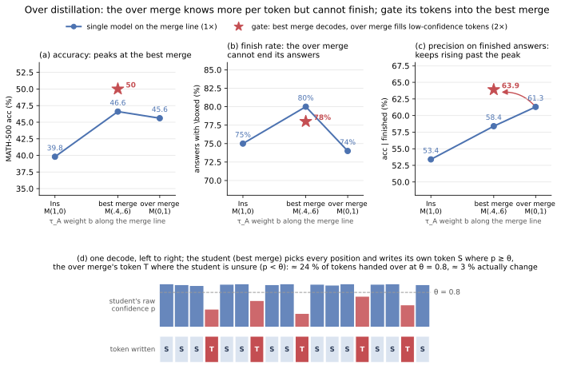

# STEP0 — Setup, baselines, and how to read the numbers

## Models (Dream-v0-7B ↔ Qwen2.5-7B; notation in `technical_details/step0_naming.md`)
τ_D = Dream-Instruct − Dream-Base (diffusion post-training vector), τ_A = Qwen-Instruct − Qwen-Base (AR post-training vector), D_b = Dream-Base.

| name | weights | role |
|---|---|---|
| Ins | D_b + τ_D | Dream-v0-Instruct |
| M(a,b) | D_b + a·τ_D + b·τ_A, a+b=1 | convex line (A2D). **M(.4,.6) = best merge** (IFEval-selected); **M(0,1) = over merge** (τ_D dropped) |
| A(β) | D_b + τ_D + β·τ_A | addition line. **A(1.1) = best addition** (IFEval-selected); **A(2.0) = over addition**; A(3.0) collapses |
| (0.7,1.3) | D_b + 0.7τ_D + 1.3τ_A | weight-space midpoint of M(.4,.6) and A(2.0), used as a 1× control |

"student ⇐ teacher @θ" = the student decodes; at steps where its raw token probability p < θ the teacher's token is written (step1_methods.md).

## Protocol
- MATH-500, lockstep decoder: 1024 tokens, 1024 steps (one token per step), top_p 0.9, confidence temperature 0.1, argmax token (deterministic: seeds change nothing).
- Subsets: **first 200** (ids 0–199, easier, used for screening), **last 300** (ids 200–499, harder, the default for every new arm since 2026-10-12), **all 500**.
  A random 100-problem subset only preserves orderings with ≥ 6 pp gaps (`technical_details/step0_subset_checks/check_500.md`); 200-vs-500 ordering is kept 65% / 82% / 98% of the time for gaps < 3 / 3–6 / ≥ 6 pp.
- Hardware: 9/30 runs on B300 (marked †), everything from 10/09 on H200 at a 0.51 fraction. Labelled in every table.
- Scoring: minerva `is_equiv` on the last `\boxed{}`; "finish" = the output contains `\boxed`. For the gated systems and A(2.0) an unfinished output is a true truncation at 1024 tokens (last 300: 27/33 and 13/17 of the unboxed outputs are ≥1000 tokens, the rest are early stops with no answer). **Ins is the exception**: 39 of its 73 unboxed outputs are complete short answers without `\boxed` ("The answer is: 28"), and a crude lenient extractor scores 25 of them correct (Ins lenient = 45.0 vs strict 36.7, last 300). M(.4,.6) +2.3 and M(0,1) +1.0 under the same extractor; A(2.0) and the gates +0.
- Pairs: McNemar win/loss with exact two-sided p.

## Baselines

| model | first 200 | last 300 | all 500 | finish (last 300) | acc on finished (last 300) | HW |
|---|---:|---:|---:|---:|---:|---|
| Ins | 44.5 | 36.7 | 39.8 | 76% | 48.5 | B300 |
| M(.4,.6) best merge | 53.5 | 42.0 | 46.6 | 81% | 51.9 | B300 |
| M(.2,.8) | 54.0 | | | | | B300 |
| M(0,1) over merge | 48.0 | 44.0 | 45.6 | 74% | 59.2 | B300 |
| A(1.1) best addition | 57.0 | | | | | H200 |
| A(2.0) over addition | 58.5 | 46.7 | 51.4 | 94% | 49.5 | H200 |
| A(3.0) | | 34.0 | | 72% | 47.0 | H200 |
| (0.7,1.3) midpoint | 54.0 | 44.3 | 48.2 | 89% | 49.8 | H200 |
| **AR Qwen2.5-7B-Instruct, strict** (lm-eval greedy 1024, `\boxed` only) | 57.0 | 55.3 | 56.0 | 78% | 70.9 | H200 |
| **AR Qwen2.5-7B-Instruct, lenient** (final answer extracted from the last sentence) | | 70.7 | 71.0 | | | H200 |

## Two facts that condition every later reading
1. **On Dream, addition > merge is a finish-rate effect, not a precision effect.** A(2.0) finishes 94% vs 81% for M(.4,.6), but on problems both finish, M(.4,.6) is more accurate (first 200: 68.7 vs 66.0 on the 150 problems all three finish; `technical_details/step0_addition_vs_merge_finish.md`). This is consistent with A2D's convex-is-best result once truncation is accounted for.
2. **The AR reference is under-scored by the strict scorer, and so is Ins.** 22% of its answers are complete but have no `\boxed`; with lenient extraction it is 71, not 56. The same lenient scorer moves our best system by ≤ 1 (its misses are real truncations), but moves Ins by +8: about 8 of the +12.3 of Ins ⇐ A(2.0) is the teacher teaching the `\boxed` format, the solving gain is ≈ +4; M(.4,.6) ⇐ A(2.0) keeps +6.7 under lenient scoring. The true gap to AR on MATH-500 is ≈ 19 points, not 4.

## Why we tried this at all (headroom)

*Main line (Ins ⇐ A(β), last 300). Adding the AR vector raises accuracy up to A(2.0) and collapses at A(3.0) (a); the whole gain is finish rate (b), the precision per finished answer does not move (c). The gate keeps the student's tokens where it is confident and takes the teacher's where it is unsure: it inherits the teacher's finish rate (93%) and is more precise than both (52.9) → 49.0. Why the unsure positions (d): A2D's teacher-forced measurement shows the AR vector rewrites a token almost only where the model is unsure about it (96% of changes at p < 0.7; at p ≥ 0.9, 61% of all tokens, one change in 15,000) — so the student's confidence is where the AR-side information lives. (e) θ sweep on the last 300; the same dose at random positions stays at the student (38.0 / 38.3). `code/step0/fig_motivation_addition.py`.*

*Second line (M(.4,.6) ⇐ M(0,1), all 500): the same gate seen from the merge line, where the over-merged model cannot finish but is more precise per answer; the gate keeps the finish rate and inherits the precision (50.0 vs 46.6 / 45.6). `code/step0/fig_motivation.py`.*

On saved outputs, "student right OR teacher right" exceeds the better single model by 6–8 points on several A2D settings (`technical_details/step0_headroom_retry_selective.md`), e.g. M(.4,.6) ∪ A(2.0) on the last 300 = 58 vs 46.7. Part of that is decoding noise (same-protocol reruns flip items), so only a router that beats a matched random control counts.
